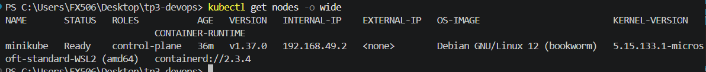
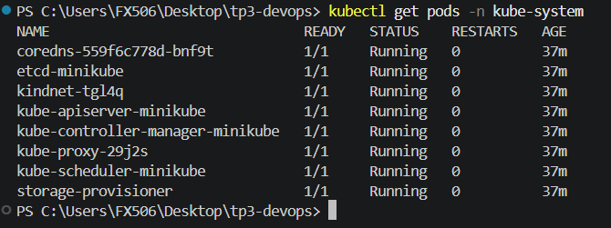
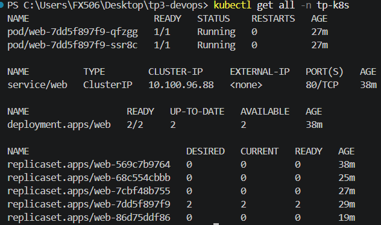
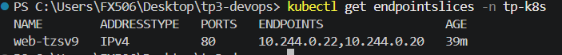
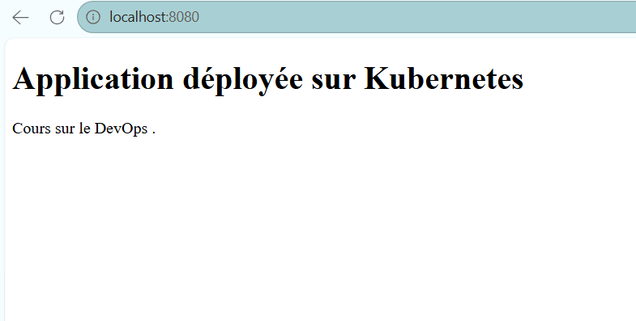
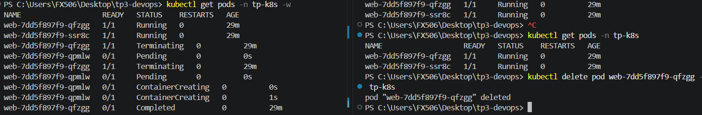
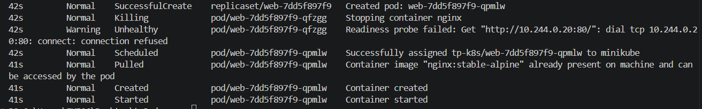
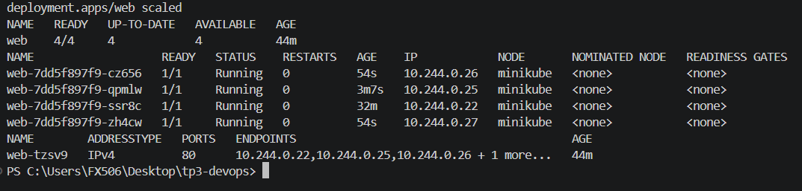
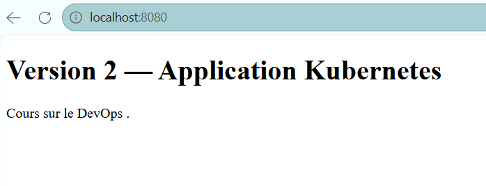
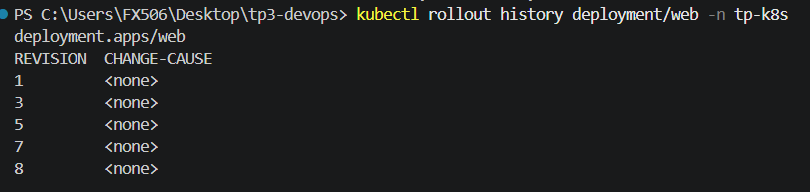

# TP Kubernetes avec Minikube – Compte rendu

**Nom :** _(ton nom)_ · **Date :** 11/11/2026

Dans ce TP, j'ai déployé une petite application web (Nginx) sur un cluster Kubernetes local avec Minikube. J'ai testé ce que Kubernetes fait tout seul (remplacer un Pod, mettre à jour, revenir en arrière) et j'ai provoqué des pannes pour apprendre à les diagnostiquer.

**Environnement :** Windows 11 · Docker Desktop (WSL2) · Minikube v1.39.0 (driver Docker) · Kubernetes v1.37.0

```powershell
minikube start --driver=docker --cpus=2 --memory=4096
```

---

## 1. Architecture du cluster

```powershell
kubectl get nodes -o wide
kubectl get pods -n kube-system
```





Mon cluster n'a qu'**un seul nœud**, `minikube`. Il est à la fois control plane (le « cerveau ») et worker (il fait tourner les applications). Il tourne lui-même dans un conteneur Docker.

### Les composants que j'ai vus dans `kube-system`

| Composant | À quoi il sert |
|---|---|
| `kube-apiserver` | Point d'entrée : `kubectl` parle avec lui |
| `etcd` | Base de données qui garde l'état du cluster |
| `kube-scheduler` | Choisit sur quel nœud placer un nouveau Pod |
| `kube-controller-manager` | Fait tourner les contrôleurs (ReplicaSet, Deployment…) qui corrigent l'état du cluster |
| `kubelet` | Agent du nœud : lance les conteneurs et exécute les probes (pas visible comme Pod) |
| `kube-proxy` | Règles réseau qui font marcher les Services |
| `coredns` | DNS interne du cluster |
| `kindnet` | Réseau des Pods (donne une IP à chaque Pod) |
| `storage-provisioner` | Crée du stockage à la demande (spécifique à Minikube) |

### Schéma

```
Mon PC Windows
└─ Docker Desktop
   └─ Conteneur "minikube" = le nœud (control plane + worker)
      ├─ Control plane : kube-apiserver · etcd · scheduler · controller-manager
      ├─ Système : kubelet · kube-proxy · CoreDNS · kindnet
      └─ Namespace tp-k8s
         ├─ Deployment web ─► ReplicaSet ─► Pod 1 + Pod 2 (nginx)
         ├─ Service web (ClusterIP) ─► envoie vers les Pods "app=web"
         └─ ConfigMap page-web ─► fournit index.html aux Pods

Moi : kubectl ─► kube-apiserver
```

### Questions

1. **Rôle du control plane ?** Il décide et surveille : il reçoit les demandes, stocke l'état, place les Pods et corrige l'état réel quand il s'écarte de l'état voulu.
2. **Nœud vs Pod ?** Un nœud est une machine. Un Pod est la plus petite unité qu'on déploie, et il tourne sur un nœud.
3. **Qui maintient le nombre de réplicas ?** Le **ReplicaSet**, créé par le Deployment.
4. **Conteneur vs Pod ?** Un Pod contient un ou plusieurs conteneurs qui partagent la même IP et les mêmes volumes.
5. **Limites d'un cluster local à un nœud ?** Si le nœud tombe, tout tombe. Pas de vraie haute disponibilité, peu de ressources, pas de vrai `LoadBalancer`, et c'est loin d'un environnement de production.

---

## 2. Déployer l'application

Je n'ai créé que 4 fichiers YAML dans le dossier `k8s/` :

| Fichier | Ressource | Rôle |
|---|---|---|
| `01-namespace.yaml` | Namespace `tp-k8s` | Espace isolé pour le TP |
| `02-configmap.yaml` | ConfigMap `page-web` | Contient la page `index.html` |
| `03-deployment.yaml` | Deployment `web` | 2 réplicas de Nginx, probes, requests/limits |
| `04-service.yaml` | Service `web` (ClusterIP) | Adresse stable vers les Pods `app=web` |

```powershell
kubectl apply -f k8s/01-namespace.yaml
kubectl apply -f k8s/02-configmap.yaml
kubectl apply -f k8s/03-deployment.yaml
kubectl apply -f k8s/04-service.yaml
kubectl get all -n tp-k8s
```



On voit le Deployment en `2/2`, les 2 Pods `Running`, le Service `web`, et **plusieurs ReplicaSets** : un seul est actif, les autres (à `0`) sont les anciennes versions gardées pour pouvoir revenir en arrière.



L'EndpointSlice contient les IP des 2 Pods : c'est la liste des destinations du Service.

Pour voir la page : `kubectl port-forward -n tp-k8s service/web 8080:80`, puis http://localhost:8080.



### Questions

- **Intérêt d'un namespace ?** Il isole les ressources (noms, droits, quotas) entre équipes ou environnements.
- **Pourquoi une ConfigMap ?** Pour séparer la configuration de l'image et du Deployment : on change la page sans reconstruire quoi que ce soit.

1. **Deployment vs ReplicaSet ?** Le Deployment gère les mises à jour, l'historique et les retours arrière. Le ReplicaSet maintient juste le nombre de Pods.
2. **Pourquoi pas l'IP des Pods ?** Elle change à chaque fois qu'un Pod est recréé. Le Service donne une adresse stable.
3. **ClusterIP / NodePort / LoadBalancer ?** `ClusterIP` : accessible seulement dans le cluster. `NodePort` : ouvre aussi un port sur le nœud. `LoadBalancer` : demande un répartiteur de charge externe (cloud).
4. **Readiness vs liveness ?** Readiness : « puis-je recevoir du trafic ? » (sinon le Pod est retiré du Service). Liveness : « suis-je encore vivant ? » (sinon le conteneur est redémarré).
5. **Limite mémoire trop basse ?** Le conteneur est tué (`OOMKilled`) et peut redémarrer en boucle.

---

## 3. Résilience : supprimer un Pod

```powershell
kubectl get pods -n tp-k8s -w                              # terminal 1
kubectl delete pod web-7dd5f897f9-qfzgg -n tp-k8s          # terminal 2
```



**Ce qui s'est passé :** l'ancien Pod passe en `Terminating`, et **tout de suite** un nouveau Pod (`qpmlw`) est créé : `Pending` → `ContainerCreating` → `Running`. Je n'ai rien fait pour ça.



Les événements racontent la même histoire : `Killing` (Pod supprimé), `SuccessfulCreate` (le ReplicaSet en crée un autre), puis `Scheduled`, `Pulled`, `Created`, `Started`. Le `Warning Unhealthy` vient de la readiness probe qui a interrogé le Pod pendant son arrêt : c'est normal.

### Questions

1. **Pourquoi le Pod est remplacé ?** Le Deployment demande 2 réplicas, et le ReplicaSet compare en permanence l'état réel à cet état voulu. S'il en manque un, il le recrée (c'est la **réconciliation**).
2. **Supprimer un Pod vs arrêter un processus ?** Supprimer un Pod : il est remplacé par un nouveau (nouveau nom, nouvelle IP). Si le processus du conteneur s'arrête : le kubelet redémarre le conteneur dans le même Pod.
3. **Redémarrage de conteneur = cluster en panne ?** Non, c'est un incident local géré automatiquement.
4. **Si le nœud tombait ?** Tout s'arrêterait : le control plane et les Pods sont sur la même machine.
5. **Pourquoi un seul nœud ne prouve pas la tolérance aux pannes ?** Il n'y a pas d'autre machine où replacer les Pods.

---

## 4. Mise à l'échelle

```powershell
kubectl scale deployment/web --replicas=4 -n tp-k8s
kubectl get deployment web -n tp-k8s
kubectl get pods -n tp-k8s -o wide
```



Le Deployment passe en `4/4` et on a 4 Pods `Running`, chacun avec sa propre IP. J'ai aussi testé `--replicas=1` (3 Pods en `Terminating`), puis remis 4, puis 2 à la fin. Juste après un `scale`, l'EndpointSlice n'avait pas encore tous les Pods : **le Service n'envoie du trafic qu'aux Pods prêts**.

### Questions

1. **Manuel vs autoscaling ?** Manuel : je choisis le nombre de réplicas. Autoscaling : Kubernetes l'ajuste selon la charge.
2. **Rôle du HPA ?** Il surveille une métrique (ex. CPU) et augmente ou diminue les réplicas entre un min et un max.
3. **Pourquoi des métriques et des ressources configurées ?** Le HPA calcule un pourcentage par rapport aux `requests` CPU, et il lui faut un serveur de métriques pour mesurer.
4. **Pourquoi 4 réplicas sur 1 nœud ne suffisent pas ?** Si le nœud tombe, les 4 tombent ensemble.

---

## 5. Mise à jour et retour arrière

Je change le titre dans la ConfigMap en « Version 2 », puis :

```powershell
kubectl apply -f k8s/02-configmap.yaml
kubectl rollout restart deployment/web -n tp-k8s
kubectl rollout status deployment/web -n tp-k8s
```

Le `rollout restart` est obligatoire : la page est montée avec `subPath`, donc les Pods existants ne voient pas le changement de la ConfigMap tout seuls.



Ensuite, j'ai testé un changement d'image puis un retour arrière :

```powershell
kubectl set image deployment/web nginx=nginx:alpine -n tp-k8s
kubectl rollout undo deployment/web -n tp-k8s
kubectl rollout history deployment/web -n tp-k8s
```

Pendant le remplacement, `rollout status` affiche « 2 out of 4 new replicas have been updated... » : les Pods sont remplacés **petit à petit**, c'est le RollingUpdate.



**Pourquoi les numéros sautent (1, 3, 5, 7, 8) ?** Quand Kubernetes revient à une configuration déjà connue, il réutilise l'ancien ReplicaSet et le renumérote en dernière révision. L'ancien numéro disparaît alors de la liste. Chaque révision correspond à une étape de mon TP :

| Révision | Ce que j'ai fait |
|---|---|
| 1 | Déploiement initial |
| 3 | `nginx:alpine` |
| 5 | Incident A (image inexistante) |
| 7 | Incident C (mauvaise probe) |
| 8 | Version actuelle, après les corrections |

### Questions

1. **RollingUpdate ?** Les Pods sont remplacés progressivement : on crée des nouveaux pendant qu'on supprime des anciens.
2. **Pourquoi la disponibilité n'est pas parfaite ?** Deux versions coexistent un moment, et une version défectueuse peut quand même causer des erreurs.
3. **Quand `rollout undo` marche ?** Tant que l'historique du Deployment existe, et seulement pour ce que le Deployment contient (image, ressources…). Il ne restaure pas une base de données.
4. **Pourquoi versionner les configs et séparer les migrations de base ?** Une migration de base ne s'annule pas avec un `undo`, et des configs versionnées permettent de revenir à un état connu.

> Attention : un tag comme `alpine` peut changer dans le temps. En production, on fige la version (voire le digest de l'image).

---

## 6. Diagnostic de 3 incidents

Démarche suivie : **symptôme → hypothèse → diagnostic → correction → vérification**. Les anciens Pods sont restés `Running` pendant chaque incident : c'est le RollingUpdate qui protège l'application.

### Incident A – Image introuvable

- **Symptôme :** le nouveau Pod `web-68c554cbbb-zd48d` reste en `0/1`, statut `ImagePullBackOff`.
- **Hypothèse :** Kubernetes n'arrive pas à télécharger l'image.
- **Diagnostic :** `kubectl describe pod` et `kubectl get events`.
  ```text
  Warning  Failed   Failed to pull image "nginx:tag-inexistant": ... nginx:tag-inexistant: not found
  Warning  Failed   Error: ErrImagePull
  Normal   BackOff  Back-off pulling image "nginx:tag-inexistant"
  ```
- **Correction :** remettre `nginx:stable-alpine` dans `03-deployment.yaml`, puis `kubectl apply`.
- **Vérification :** `deployment "web" successfully rolled out`, Pods en `1/1 Running`.

### Incident B – Service inaccessible

- **Symptôme :** les 2 Pods sont `Running`, mais le Service n'a plus de destination.
- **Hypothèse :** le Service ne trouve plus les Pods.
- **Diagnostic :** `kubectl get endpointslices` et `kubectl describe service web`.
  ```text
  NAME        ADDRESSTYPE   PORTS     ENDPOINTS   AGE
  web-tzsv9   IPv4          <unset>   <unset>     16m

  Selector:  app=web-inexistant
  ```
  Le sélecteur du Service ne correspond à aucun label de Pod (`app=web`).
- **Correction :** remettre `app: web` dans `04-service.yaml`, puis `kubectl apply`.
- **Vérification :** l'EndpointSlice liste de nouveau les IP `10.244.0.22, 10.244.0.20`.

**À retenir :** un Pod peut très bien fonctionner alors que l'application est inaccessible : le Service n'est qu'une couche de routage basée sur les labels.

### Incident C – Mauvaise readiness probe

- **Symptôme :** le nouveau Pod `web-86d75ddf86-...` est `Running` mais reste en `0/1` pendant environ 2 minutes, alors que les 2 anciens Pods restent `1/1`.
- **Hypothèse :** sa readiness probe échoue.
- **Diagnostic :** j'avais configuré la probe sur `/inexistant`, une page que Nginx n'a pas : la probe reçoit une erreur 404 et le Pod n'est jamais « prêt », donc il ne reçoit pas de trafic.
- **Correction :** remettre `path: /` dans la `readinessProbe`, puis `kubectl apply`.
- **Vérification :** `successfully rolled out`, Pods `1/1`, endpoints rétablis.

**Readiness vs liveness en échec :** readiness en échec = le Pod est retiré du Service (pas redémarré). Liveness en échec = le conteneur est redémarré. Une sonde mal réglée peut donc rendre une application indisponible.

Après chaque expérience, j'ai remis les manifestes dans un état fonctionnel.

---

## 7. Limites d'un cluster local vs production

| Sujet | Minikube (local) | Production |
|---|---|---|
| Nœuds | Un seul, control plane compris | Plusieurs workers et un control plane redondant |
| Pannes | Si le nœud tombe, tout tombe | Les Pods sont replacés sur d'autres nœuds |
| Réseau | `port-forward`, pas de vrai `LoadBalancer` | `LoadBalancer`, Ingress, DNS, TLS |
| Stockage | Local, non répliqué | Volumes répliqués et sauvegardés |
| Ressources | Celles de mon PC | Dimensionnées + autoscaling |
| Sécurité | Minimale | RBAC, politiques réseau, secrets |
| Supervision | `kubectl` seulement | Métriques, logs centralisés, alertes |

---

## 8. Mini-projet : ce qui est couvert

- [x] 2 réplicas, namespace et Service dédiés
- [x] Probes de santé (readiness + liveness)
- [x] Requests et limits CPU/mémoire (50m/250m CPU, 32Mi/128Mi mémoire)
- [x] Remplacement automatique d'un Pod supprimé
- [x] Mise à l'échelle manuelle
- [x] Mise à jour puis retour arrière
- [x] Incident provoqué et diagnostiqué (3 incidents)
- [x] Commandes et observations documentées
- [x] Choix et limites justifiés

---

## 9. Conclusion

Avec Docker seul, je lance des conteneurs et je dois tout surveiller moi-même. Avec Kubernetes, je **décris l'état voulu** (2 réplicas, telle image, telles probes) et le cluster se charge de le maintenir : il remplace un Pod supprimé, change le nombre d'instances en une commande, met à jour progressivement et permet de revenir en arrière.

Mais Kubernetes ne fait pas tout. Pour être fiable en production, il faut encore : plusieurs nœuds (pour survivre à la panne d'une machine), des probes et des ressources bien réglées, des versions d'images figées, des configurations versionnées, des migrations de base de données planifiées à part, des sauvegardes, de la supervision et de la sécurité.

---

## Nettoyage

```powershell
kubectl delete namespace tp-k8s
minikube stop        # arrêter le cluster
```
